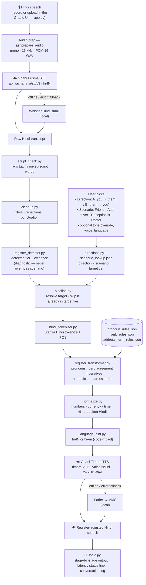

# Register-Aware Bidirectional Voice Translation for Hindi

> **Solution pitch (1 page): [PITCH.md](PITCH.md)** · Speech runs on Gnani AI **Prisma** (ASR) and **Timbre** (TTS).
>
> **Quick start:** add `GNANI_API_KEY` to `.env`, then run `python app.py` and open http://127.0.0.1:7860.

## 1. Project overview

This project is a proof-of-concept Hindi voice translation system designed to
preserve the social register appropriate to the person being addressed. Hindi
changes pronouns, verb agreement, imperatives, honorifics, and address terms
depending on relationships such as friend, teacher, elder relative, customer,
or auto driver. The system converts Hindi speech to text with **Gnani Prisma**,
maps the user-selected scenario and conversation direction to one of six
register tiers, deterministically rewrites the text for that relationship, and
speaks the result with **Gnani Timbre**. A Gradio web app runs the full
audio-to-audio loop for both sides of a conversation and keeps a turn-by-turn log.

## 2. Architecture

### 2.1 End-to-end flow



### 2.2 Stage by stage

| # | Stage | Module | What it does |
|---|---|---|---|
| 1 | Input | `app.py`, `ui_logic.py` | Gradio UI: record or upload audio, choose direction (A/B), scenario, tone override, Timbre voice and language. |
| 2 | Audio prep | `asr.py` | Converts any input to mono 16 kHz PCM-16 WAV; rejects clips over 60 s for Prisma. |
| 3 | Speech-to-text | `asr.py` → **Gnani Prisma** | `POST api.vachana.ai/stt/v3` with `language_code=hi-IN`. Falls back to local Whisper (`vasista22/whisper-hindi-small`) if the cloud call fails or cloud mode is off. |
| 4 | Script check | `script_check.py` | Flags Latin or mixed-script words that the register rules can't handle and warns the user. |
| 5 | Cleanup | `cleanup.py` | Removes fillers and accidental repetitions (keeping valid reduplication like धीरे धीरे) and fixes punctuation. |
| 6 | Register detection | `register_detector.py` | Classifies the sentence into one of six tiers using pronoun, verb and honorific evidence. Shown for transparency only. |
| 7 | Target selection | `directions.py`, `scenario_dial.py`, `scenario_lookup.json` | Direction × scenario gives the authoritative target tier; the user's tone override wins if set. |
| 8 | Tokenize + tag | `hindi_tokenizer.py` | Stanza Hindi tokenization and POS tagging feed the transformer. |
| 9 | Transformation | `register_transformer.py` + `*_rules.json` | Rewrites pronouns (तू / तुम / आप), verb agreement and imperatives (बैठ जा → बैठ जाइए), and adds or removes honorifics and address terms (जी, सर, कृपया). |
| 10 | TTS normalization | `normalize.py` | Turns numbers, currency, times and percentages into spoken Hindi words. |
| 11 | Language hint | `language_hint.py` | Picks `hi-IN`, or `hi-en` for code-mixed sentences. |
| 12 | Text-to-speech | `tts.py` → **Gnani Timbre** | `POST api.vachana.ai/api/v1/tts/inference`, model `timbre-v2.5`, voice *Nalini*, speed 1.0. Falls back to local Parler, then MMS. |
| 13 | Output + log | `ui_logic.py` | Plays the audio, shows every intermediate stage, per-stage latency, and appends the turn to the conversation log. |

### 2.3 Register tiers and scenarios

Six tiers, from most casual to most formal: **Full Informal** (तू), **Respectful
Casual** (तुम), **Formal** (आप), **Full Formal** (आप + जी/सर), plus two
special tiers: **Formal-Warm** (close but deferential, e.g. a grandparent, with
kinship address like दादी जी) and **Reverse Formal** (you serving a customer, so
you owe the deference).

| Scenario | Target tier | Example: *तू कहाँ जा रहा है?* becomes |
|---|---|---|
| Friend | Full Informal | तू कहाँ जा रहा है? |
| Auto driver | Respectful Casual | तुम कहाँ जा रहे हो? |
| Receptionist | Formal | आप कहाँ जा रहे हैं? |
| Doctor | Full Formal | सर, आप कहाँ जा रहे हैं? |

### 2.4 Bidirectional conversation

Every turn runs through the same pipeline. **Direction A** (you → them) converts
your speech into the register the listener expects; **Direction B** (them → you)
converts their reply for you. `conversation.py` runs a whole multi-turn
dialogue from the command line, and the web UI keeps the same history in its
conversation log.

### 2.5 Reliability and privacy

- Both Gnani calls have timeouts, and every failure falls back to a local model,
  so a turn still completes offline.
- A failure in one stage never crashes the turn: detection, transformation and
  normalization each fall back to passing the text through unchanged, and the UI
  shows a plain-language error.
- `GNANI_API_KEY` is read from `.env` and redacted from every log line and UI message.

## 3. Prerequisites

### Platform and Python

- Python **3.12.13** is the verified version in `SETUP_NOTES.md`.
- Python 3.9 or newer is required by the project plan; Python 3.12 is the
  reproducible choice for this repository.
- The supplied ASR runner requires an Apple Silicon Mac with a working PyTorch
  MPS backend. It intentionally raises an error instead of falling back to CPU.
- The text-only register modules and tests do not require MPS.

Check Python and Apple MPS:

```bash
python3 --version
python3 -c "import torch; print('built=', torch.backends.mps.is_built()); print('available=', torch.backends.mps.is_available())"
```

Both MPS values must be `True` before running `asr_baseline.py`.

### Python dependencies actually used

The pinned direct dependencies are in `requirements.txt`:

| Package | Version | Used for |
|---|---:|---|
| `torch` | 2.7.1 | MPS inference |
| `transformers` | 5.17.0 | Whisper processor and ASR model |
| `soundfile` | 0.14.0 | Reading and writing audio |
| `librosa` | 1.0.0 | Resampling to 16 kHz |
| `indic-nlp-library` | 0.92 | Hindi token boundaries |
| `stanza` | 1.14.0 | Hindi POS tagging |

`numpy` is also imported directly by `asr_baseline.py`; it is installed as a
dependency of the packages above (the verified environment currently has
NumPy 2.5.3).

Install the recorded dependency set with:

```bash
python -m pip install -r requirements.txt
```

### TTS dependency status

**No TTS module, model identifier, or TTS library is currently present in the
repository or `requirements.txt`.** There is therefore no truthful TTS install
or model-load command to provide yet. A TTS library must be selected and added
before the final audio-output stage can run.

## 4. Setup instructions

### 4.1 Obtain the files

No remote Git URL is recorded in this repository, so use the team-provided
clone URL if one exists. To use the supplied handoff archive:

```bash
unzip harshita_handoff_bundle.zip -d hindi-register-handoff
cd hindi-register-handoff
```

The handoff archive intentionally excludes model caches and audio files. When
working in the original project checkout, run the remaining commands from the
directory containing this `README.md`.

### 4.2 Create and activate an isolated environment

```bash
python3 -m venv .venv
source .venv/bin/activate
python -m pip install --upgrade pip
python -m pip install -r requirements.txt
python -m pip check
```

### 4.3 Download the Hindi Stanza resources

`hindi_tokenizer.py` loads resources only from `.cache/stanza` and does not
download them at runtime. Download the exact tokenizer/POS packages it expects:

```bash
python -c "import stanza; stanza.download('hi', model_dir='.cache/stanza', processors={'tokenize': 'hdtb', 'pos': 'hdtb_charlm'})"
```

Confirm tokenization and POS tagging:

```bash
python -c "from hindi_tokenizer import tokenize_and_tag; print(tokenize_and_tag('तुम कहाँ रहते हो?'))"
```

### 4.4 Confirm the ASR model loads on MPS

The ASR script automatically downloads
`vasista22/whisper-hindi-small` through Transformers on its first run. The
original checkout includes WAV inputs referenced by `sample_audio/manifest.json`.
Run a one-clip smoke test without overwriting the recorded baseline:

```bash
HF_HOME=.cache/huggingface python -u asr_baseline.py \
  --limit 1 \
  --output-dir /tmp/hindi-asr-smoke-audio \
  --results /tmp/hindi-asr-smoke-results.json
```

A successful run prints values including:

```text
model=vasista22/whisper-hindi-small
mps_built=True
mps_available=True
model_device=mps:0
```

It also preprocesses the input to mono 16 kHz PCM WAV and writes the temporary
result JSON. If using the handoff archive alone, supply the omitted audio files
and update a compatible manifest before running this smoke test.

### 4.5 TTS model check

There is no TTS code or selected model to check. This setup step remains
blocked until a TTS module and dependency are added.

## 5. How to run

### Full audio-to-audio pipeline

**There is currently no full-pipeline command.** The repository has no TTS
module, text-cleanup module, microphone/UI entry point, or pipeline
orchestrator. `asr_baseline.py` runs only the manifest-driven audio-to-text
baseline; it does not call `scenario_to_dial()`, `transform()`, or TTS.

The existing ASR batch can be run with:

```bash
HF_HOME=.cache/huggingface python -u asr_baseline.py
```

This uses `sample_audio/manifest.json`, writes standardized audio under
`sample_audio/processed`, and writes `asr_baseline_results.json`. It requires
MPS and the audio files from the original checkout.

### Run the text transformation layer

There is no dedicated transformation CLI yet. Invoke the tested Python API
directly. This example selects the `auto_driver` scenario, which resolves to
Respectful Casual, and rewrites a masculine addressee sentence:

```bash
python -c 'from scenario_dial import scenario_to_dial; from register_transformer import transform; scenario="auto_driver"; tier=scenario_to_dial(scenario); text="तू क्या कर रहा है?"; print("tier:", tier); print("output:", transform(text, tier, "M"))'
```

Expected output:

```text
tier: Respectful Casual
output: तुम क्या कर रहे हो?
```

For the two tag-based tiers, pass scenario context and a validated address term.
For example:

```bash
python -c 'from scenario_dial import scenario_to_dial; from register_transformer import transform; scenario="elder_relative"; tier=scenario_to_dial(scenario); print(transform("तुम कैसी हो?", tier, "F", scenario=scenario, address_term="नानी जी"))'
```

Expected output:

```text
नानी जी, आप कैसी हैं?
```

Run diagnostic register detection separately:

```bash
python -c 'from register_detector import detect_register, detect_register_details; text="आप कहाँ रहते हैं?"; print(detect_register(text)); print(detect_register_details(text))'
```

Do not use the detected result to override an explicit user-selected scenario.

## 6. Running the test suite

From the project root with the virtual environment active:

```bash
python -m unittest discover -s tests -v
```

The current expected summary is:

```text
Ran 53 tests

OK
```

The suite covers scenario lookup, tokenization/POS flags, pronoun and verb rule
tables, all 48 tagged sentences, 144 cross-tier transformations, register
detection, postpositional cases, and Formal-Warm/Reverse Formal branches.

Additional evaluation output can be reproduced with:

```bash
python register_detection_baseline.py
python cross_tier_review.py
```

The current recorded results are 144/144 passing cross-tier transformations,
48/48 passing detection-to-transformation smoke cases, and 36/48 (75%) correct
standalone register detections.

## 7. Known limitations

- `detect_register()` has a documented 75% text-only accuracy ceiling on the
  locked set. Four tiers—Formal, Full Formal, Formal-Warm, and Reverse
  Formal—share the `आप` pronoun paradigm and respectful-plural verb morphology.
  Some lower-tier sentences also use `तुम` in both Full Informal and Respectful
  Casual. Relationship and participant-role context is not always present in a
  sentence, so the user-selected scenario is the authoritative target and
  detection is diagnostic only.
- Hindi ASR has register-critical weak spots: short `तू` may be recognized as
  `तो`; respectful or gendered verb constructions can flatten (for example,
  `सकते हैं` to `सकता है`); and short honorific/address terms may be dropped.
- The ten-clip Day 2 ASR batch does not yet have supplied reference transcripts,
  so its manual correctness labels and WER remain pending. See
  `ASR_BASELINE.md` for the recorded outputs and timing data.
- The ASR runner is hard-coded to require Apple MPS and refuses CPU fallback.
- No text-cleanup/normalization stage has been implemented yet, despite the ASR
  weaknesses above.
- No TTS module or dependency has been selected or implemented.
- No microphone/UI runner, full bidirectional orchestrator, or single-command
  audio-to-audio entry point exists yet.
- The transformation layer is intentionally rule-based and degrades gracefully
  by preserving unsupported words or constructions.

## 8. Project structure

```text
.
├── README.md                         # This run/setup guide
├── requirements.txt                 # Pinned Python dependencies
├── asr_baseline.py                  # Manifest-driven Whisper ASR/MPS runner
├── hindi_tokenizer.py               # Indic NLP tokenization + Stanza POS tags
├── scenario_dial.py                 # scenario_to_dial() public API
├── scenario_lookup.json             # 20 scenarios, P/D/C values, thresholds
├── register_transformer.py          # transform() public API
├── register_detector.py             # detect_register() diagnostic API
├── register_detection_baseline.py   # 48-case detection/smoke evaluator
├── cross_tier_review.py             # Generates the 144 transformation cases
├── pronoun_rules.json               # Pronoun/postpositional forms by tier
├── verb_rules.json                  # Tier × gender × tense verb patterns
├── address_term_rules.json          # Honorific/address and scenario overrides
├── register_test_sentences.json     # 48 tagged Hindi evaluation sentences
├── asr_baseline_results.json        # Three-clip ASR baseline results
├── day2_asr_results.json            # Ten-clip Day 2 ASR results
├── transformation_failure_log.json  # Resolved transformation failure history
├── day6_bug_list.json               # Consolidated bug/limitation status
├── sample_audio/
│   ├── manifest.json                # Three-clip ASR input/reference manifest
│   ├── day2_manifest.json           # Ten-clip Day 2 manifest
│   ├── raw/                         # Source WAV files (original checkout)
│   ├── processed/                   # Standardized/generated audio
│   └── day2_standardized/           # Standardized Day 2 audio
├── tests/                            # 53 unittest cases across nine modules
├── SETUP_NOTES.md                   # Verified versions, MPS and model notes
├── ASR_BASELINE.md                  # ASR timing, outputs, and weak spots
├── SCENARIO_REFERENCE.md            # Full P/D/C framework and scenario table
├── PRONOUN_RULES.md                 # Pronoun-case audit documentation
├── VERB_ADDRESS_RULES.md            # Verb and address policy documentation
├── REGISTER_DETECTION_BASELINE.md   # Confusion matrix and 75% limitation
├── REGISTER_SELECTION_ARCHITECTURE.md # Required scenario-first UI contract
└── REPORT_READY_METHOD_EVALUATION.md  # Report-ready methods/evaluation prose
```

Generated/cache directories such as `.venv`, `.cache`, and `__pycache__` are
not source files and are excluded from version control and the handoff archive.

---

## Task 1 — TTS Setup

### Overview

`tts.py` exposes a single public function:

```python
from tts import speak

out_path = speak(
    text="आप कहाँ जा रहे हैं?",
    out_path="output.wav",   # parent dirs created automatically
    backend="timbre",        # "timbre" | "parler" | "mms" (default: config.TTS_BACKEND)
    speed=1.0,               # 0.5–2.0 (ignored by MMS)
    voice="Nalini",          # Timbre only (ignored by Parler/MMS)
)
```

`tts.last_backend_used` holds the name of the backend that actually wrote the file
(useful when a fallback was triggered).

Three backends are supported in priority order:

| # | Backend | Type | Model |
|---|---------|------|-------|
| 1 | **timbre** | Cloud | Gnani AI `timbre-v2.5` via `api.vachana.ai` |
| 2 | **parler** | Local CPU | `ai4bharat/indic-parler-tts` |
| 3 | **mms** | Local CPU | `facebook/mms-tts-hin` (VITS) |

If backend 1 fails (network error, timeout, bad status code) the module
automatically tries backend 2, then backend 3.

### 1 · Set the API key

```bash
# Copy the example file and fill in your Gnani key.
copy .env.example .env
# Edit .env and replace "your_key_here" with the real value.
notepad .env
```

`.env` is in `.gitignore` and will never be committed.

### 2 · Install dependencies

The project venv (`tts-env`) already has all required packages.
To recreate from scratch:

```powershell
python -m venv tts-env
tts-env\Scripts\pip install -r requirements.txt
# Parler TTS (not yet on PyPI — install from GitHub):
tts-env\Scripts\pip install git+https://github.com/huggingface/parler-tts.git
```

### 3 · Run the backend comparison

```powershell
tts-env\Scripts\python.exe tests/tts_compare.py
```

This will:
- Run all 10 test sentences through every backend at speed 1.0
- Run the Timbre backend additionally at speeds 0.85 and 1.15
- Save WAV files to `tts_out/<backend>/`
- Write `tts_out/results.csv` with latency and duration measurements
- Write `tts_out/index.html` — open in any browser to listen side-by-side

```powershell
# Open the comparison page in your default browser:
start tts_out\index.html
```

### 4 · Change the active backend

Edit `config.py`:

```python
TTS_BACKEND = "mms"          # use MMS as primary
TTS_FALLBACK_ORDER = ["mms", "parler", "timbre"]
```

Or pass `backend=` directly to `speak()` without touching config.

### 5 · Voice and speed settings

| Setting | Where | Effect |
|---------|-------|--------|
| `TIMBRE_VOICE` | `config.py` | Fixed to `"Nalini"` (Gnani Hindi female) |
| `TIMBRE_SPEED` | `config.py` | Default speed sent to the API |
| `PARLER_DESCRIPTION` | `config.py` | Natural-language voice description; pace wording is substituted at runtime based on the `speed` argument |
| MMS speed/voice | N/A | MMS has no speed or voice control |
